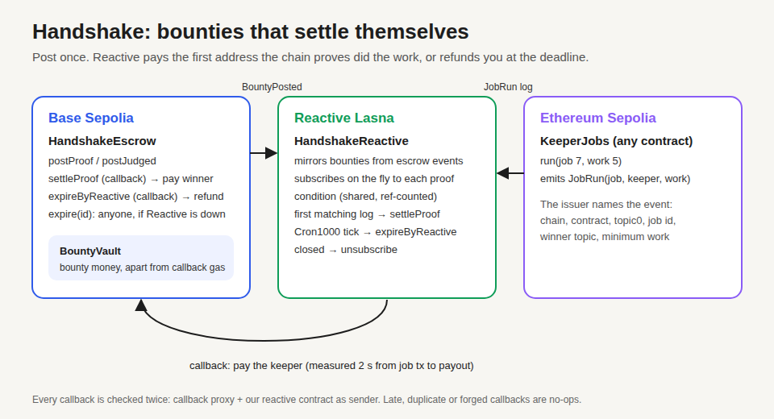

# Handshake: bounties that settle themselves

Post a bounty and walk away. Handshake pays the winner the moment the chain proves the work was done, on whichever chain it
happened, and refunds you by itself if the deadline passes. No keeper bot, no server, no reminder in your calendar.

Built on [Reactive Network](https://reactive.network) for the Reactive Omni Buildathon (track: Set It and Forget It).



## Why

I post small bounties and I claim them. Two chores eat my time:

1. **Deadlines.** A bounty nobody wins has to be cancelled and refunded by hand. Miss the date and the money stays stuck.
2. **Provable jobs.** Many jobs are on-chain facts: "run job 7", "settle order 12", "relay this message". Someone still has to
   watch for the event, check who did it and send the payment.

Handshake turns both into event-driven logic on Reactive Network, so a bounty needs no attention after it is posted.

## How it works

| Contract | Chain | Role |
|---|---|---|
| `HandshakeEscrow` + `BountyVault` | Base Sepolia | Holds bounties. Pays or refunds only through checked callbacks, or `expire(id)` by anyone after the deadline. |
| `HandshakeReactive` | Reactive Lasna | Mirrors bounties from escrow events, subscribes on the fly to each proof condition, pays the first proof, refunds on Cron1000 ticks. |
| `KeeperJobs` | Ethereum Sepolia | Tiny demo job board whose `run(job, work)` emits the proof event. Any contract's event works. |

Two kinds of bounty:

- **Proof bounty.** The issuer names an event as the condition: chain, contract, topic0, an optional pinned topic1 (for example
  the job id), which topic holds the winner, and a minimum value. Example: `JobRun(jobId = 7, keeper, work >= 3)` on Ethereum
  Sepolia. The first matching log pays the address in the named topic, on Base Sepolia.
- **Judged bounty.** The issuer accepts a claim and it pays out at once. If nobody is accepted by the deadline, the issuer is
  refunded automatically.

Subscriptions are dynamic: bounties that share a condition share one subscription (reference counted), and the last one to close
unsubscribes.

## Safety

- Every callback is checked twice: the callback proxy (`onlyServiceProvider`) and our reactive contract as the sender.
- The escrow re-checks everything on its own chain: still open, right kind, before or after the deadline on this chain's clock.
  Late, duplicate or forged callbacks are no-ops that emit `CallbackSkipped`. They never revert, so a failing callback can't loop
  and burn fees.
- Bounty money sits in a separate `BountyVault`. Callback gas is billed to the escrow's own float, so a fee can never touch a bounty.
- First valid proof wins. A proof after the deadline pays nothing and the bounty is refunded instead.
- If Reactive ever stops, anyone can call `expire(id)` on a due bounty. Funds can only go back to the issuer.

## It runs (testnets, 17 Nov 2026)

Addresses:

- Reactive contract (Lasna): `0xb7B6a6E5Fc852FBcC5E62a0db92e0edb6429d769`
- Escrow (Base Sepolia): `0xb7B6a6E5Fc852FBcC5E62a0db92e0edb6429d769` (same deployer and nonce, so the same address)
- BountyVault (Base Sepolia): `0xc1a9836d3dD82921579588eDaED0AF8d1f55f673`
- KeeperJobs (Ethereum Sepolia): `0xc964f01ed8087f51b6DD1F6434bd268176Fbf212`

Proof loop, end to end:

1. Post a proof bounty for job 1794944716 on Base Sepolia:
   [0x87db67d6…](https://sepolia.basescan.org/tx/0x87db67d67cc1c734ef95ba0e005505c04b195e3b5328c88e5f3a3a320f2636fc)
2. A keeper wallet that is not the issuer (`0x950B75A737993033108015974dDcDdC39185BBf3`) runs the job on Ethereum Sepolia:
   [0x0f250aa8…](https://sepolia.etherscan.io/tx/0x0f250aa8e33ce6de0f8319f2a6b357028c2121499b1cbaa36c769b3990105151)
3. The reactive contract sees the log on Lasna and requests the payout:
   [0xaf8f8513…](https://lasna.reactscan.net/tx/0xaf8f85131db7df89e3da27337dd4e78895ba28f67d99527e03a87530fb772c3b)
4. The callback pays the keeper 0.0005 ETH on Base Sepolia (`BountyPaid`, via reactive):
   [0xdf482835…](https://sepolia.basescan.org/tx/0xdf48283586407fddb8e1c0c55aeab613dfa862a068bfaaa82f3e01ff56ce1fb7)

Measured: **2 seconds** from the job transaction's block to the payout's block.
Dynamic subscription: subscribe [0xe94253ae…](https://lasna.reactscan.net/tx/0xe94253aec7eac2701f3fc456db274ed490765904eb897d14f2fdee777a369375),
close and unsubscribe [0x0082686c…](https://lasna.reactscan.net/tx/0x0082686cd29af2460724d7aec744e4642d0fc1379229d3caa4c199cd20e605f5).

Deadline loop: a judged bounty with a 20-minute deadline
([0x0c6c6287…](https://sepolia.basescan.org/tx/0x0c6c628781eb04f706d5a9d8ac89264f45052872db07c1b7f112c94655c0b7f8)) is refunded by a
Cron1000 tick with no transaction from anyone. See `demo_log.md` for the refund transactions.

## Run it yourself

```shell
forge test                                   # 10 tests, see below
./script/fund.sh lreact 0.02                 # Sepolia ETH -> Lasna lREACT (Reactive's faucet contract)
./script/fund.sh base 0.01                   # Sepolia ETH -> Base Sepolia (L1StandardBridge)
RX_FUND=1.5ether ESC_FUND=0.002ether ./script/deploy.sh
./script/demo.sh                             # proof loop + a judged bounty that refunds itself; writes demo_log.md
```

The scripts read a testnet key from an env file (`RX_TN_KEY`, `RX_TN_ADDR`; optionally a second key `RX_KEEPER_KEY` for the keeper).

Tests (`forge test`, 10/10): cross-chain proof payout; wrong-job and too-little-work filters; deadline refund; accept stops expiry;
a late proof refunds instead of paying; forged callbacks (wrong caller, wrong reactive sender, `react()` from a stranger); a duplicate
callback can't pay twice; callback fees never touch bounty money; a shared subscription is kept until the last bounty closes;
posting rules fail closed.

## Limits

- Testnets only. Native ETH bounties only (ERC-20 is next).
- The deadline refund fires on the first Cron1000 tick after the deadline (about every 17 minutes), not at the exact second.
- The issuer has to describe the proof event correctly; the escrow checks the shape, not the meaning.

## License

MIT
